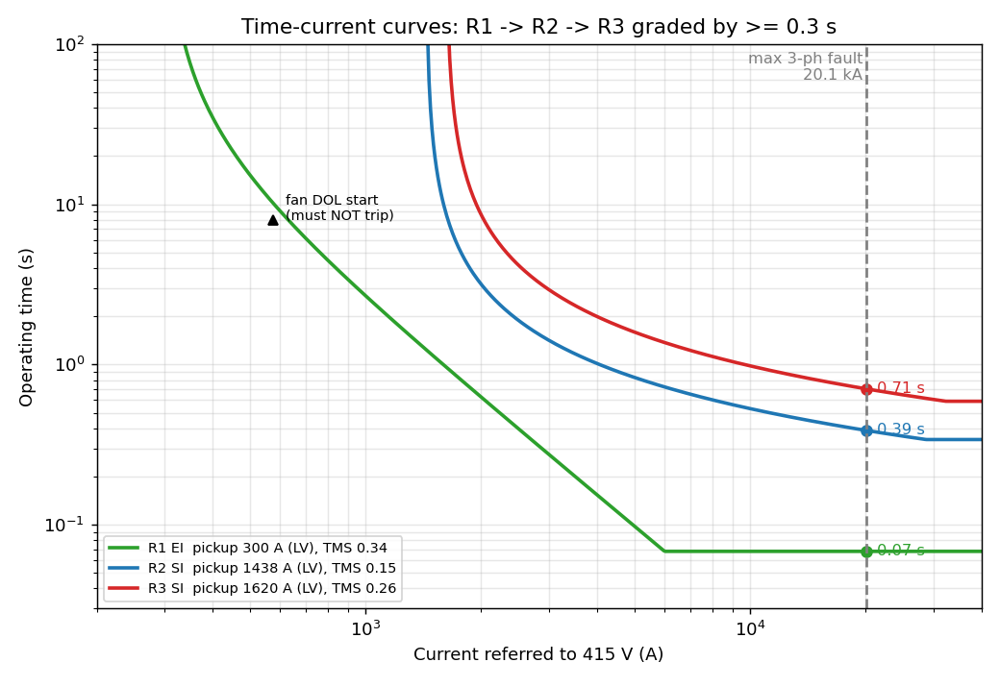
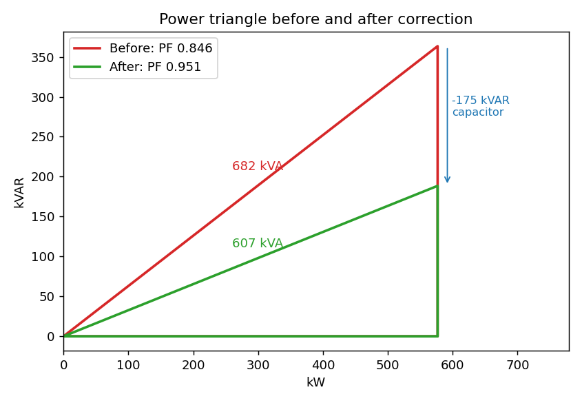
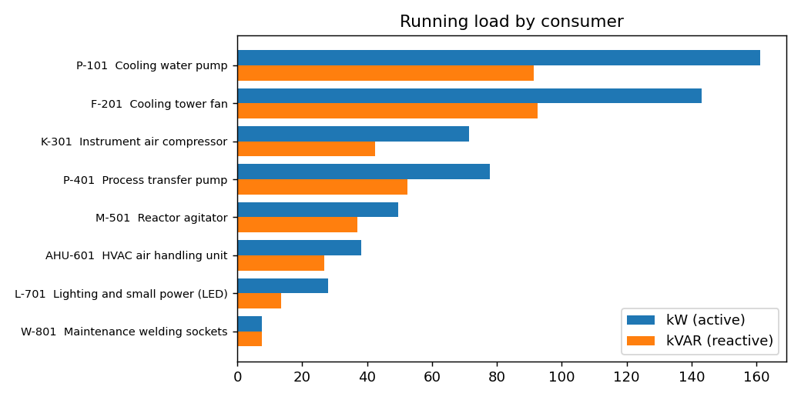

# Industrial Plant Electrical Study: Load, Power-Factor Correction, Fault Level & Relay Coordination

A Python tool that does the first electrical calculations an engineer makes for a plant substation:
it takes a **load list for a 415 V utilities MCC** (cooling-water pumps, cooling-tower fans, air compressor,
agitators, HVAC, lighting) and works out:

1. Running **kW / kVAR / kVA and plant power factor**
2. **Capacitor bank (APFC) size** to correct PF from 0.846 to 0.95
3. **Transformer rating** (11/0.433 kV) with and without correction
4. **Three-phase fault level** at the 415 V bus (per-unit method) and switchgear rating
5. **IDMT overcurrent relay settings** (plug setting + TMS) for three relays, graded 0.3 s apart, plus a
   motor-starting check

Everything is regenerated from `data/mcc_loads.csv` by one command, so the same tool works for any load list.

```
11 kV bus --[R3, VCB]-- 800 kVA 11/0.433 kV Dyn11 --[R2, ACB]-- 415 V MCC bus --[R1]-- cooling-tower sub-MCC
```

## Key results ([full auto-generated report](results/study_report.md))
| Item | Result |
|---|---|
| Running load | 576.8 kW, 363.5 kVAR, 681.7 kVA, **PF 0.846** |
| Capacitor bank | 173.9 kVAR needed -> **175 kVAR APFC (7 x 25 kVAR)**, PF -> **0.951** |
| Effect | Current 948 A -> 844 A (**-11 %**), I²R loss **-20.8 %**, 75 kVA of capacity freed |
| Transformer | **1000 kVA without correction vs 800 kVA with correction** (20 % future margin) |
| Fault level (415 V) | 20.1 kA from grid + 4.2 kA motor contribution = **24.3 kA** -> 36 kA switchgear |
| Relays | R1 EI TMS 0.34 -> 0.07 s, R2 SI TMS 0.15 -> 0.39 s, R3 SI TMS 0.26 -> 0.71 s at 20.1 kA |



<p float="left">


</p>

## The calculations by hand (what to say in an interview)

**1. Running load** for each consumer: `kW_in = rated kW x load factor / efficiency x number running`,
`kVAR = kW tan(cos⁻¹ PF)`. Example, cooling-water pumps: 90 x 0.85 / 0.95 x 2 = 161.1 kW;
tan(cos⁻¹ 0.87) = 0.567, so 91.3 kVAR. Summing all: P = 576.8 kW, Q = 363.5 kVAR,
S = √(P² + Q²) = 681.7 kVA, PF = P/S = 0.846.

**2. Capacitor size:** `Qc = P (tan φ1 - tan φ2) = 576.8 (0.6302 - 0.3287) = 173.9 kVAR`, rounded up to
standard 25 kVAR steps = 175 kVAR. An APFC relay switches steps in/out so PF stays near 0.95 as load changes
(a fixed bank would over-correct at light load and raise the voltage).

**3. Transformer:** 681.7 x 1.2 = 818 kVA -> next standard 1000 kVA. After correction 606.8 x 1.2 = 728 kVA
-> 800 kVA. *Correcting PF saves a whole transformer size.*

**4. Fault level** (base = 0.8 MVA): Z_source = 0.8/250 = 0.0032 pu, Z_transformer = 5 % = 0.05 pu,
total 0.0532 pu. I_base = 800 kVA / (√3 x 433 V) = 1067 A, so I_fault = 1067 / 0.0532 = **20.1 kA**.
Running motors act as generators for a few cycles (~4 x their FLC = 4.2 kA), so switchgear must be rated above
24.3 kA: choose 36 kA.

**5. Relay grading.** IEC Standard Inverse: `t = TMS x 0.14 / (PSM^0.02 - 1)`, where
PSM = fault current / pickup current.
- R1 (fan feeder): pickup 300 A. Uses the **Extremely Inverse** curve `t = TMS x 80 / (PSM² - 1)` because a
  37 kW fan starting direct-on-line draws ~573 A for ~8 s. EI is slow at that low overcurrent (no nuisance
  trip) but very fast for real faults (0.07 s).
- R2 (LV incomer): pickup 1437.5 A, PSM = 20051/1437.5 = 13.95,
  t = 0.15 x 0.14/(13.95^0.02 - 1) = 0.15 x 2.587 = **0.39 s** (0.32 s after R1).
- R3 (11 kV side): the same fault is 20051 x 433/11000 = 789 A on the HV side; pickup 63.75 A, PSM = 12.4,
  t = 0.26 x 2.713 = **0.71 s** (0.32 s after R2). R3 also has an instantaneous element at 1026 A for HV-side faults.
- The 0.3 s margin covers breaker opening time (~0.1 s), relay overshoot and CT errors. The code checks the
  margin at every current, not just at the maximum fault.

## Run it
```bash
pip install -r requirements.txt
python src/study.py            # prints the report, writes results/study_report.md + 3 plots
```
To study a different plant, edit `data/mcc_loads.csv` or the `CFG` dictionary at the top of `src/study.py`
(target PF, source fault level, tariffs, grading margin).

## Assumptions and limits
- Source fault level (250 MVA at 11 kV), transformer %Z (IS 1180 / IS 2026 typical values) and tariffs are
  **assumed, illustrative values**.
- Cable impedance is ignored in the fault calculation (gives the worst case, i.e. highest current).
- Harmonics: a plant with many VFDs needs a **detuned (7 %) reactor** with the capacitor bank to avoid
  resonance. That is noted, not modelled.
- Earth-fault (51N) settings, arc-flash and voltage-drop studies are next steps (ETAP does all of this
  commercially).
